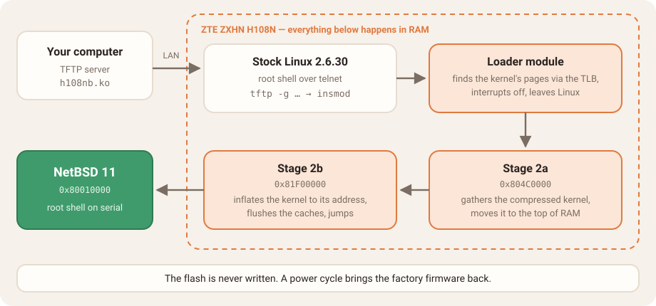
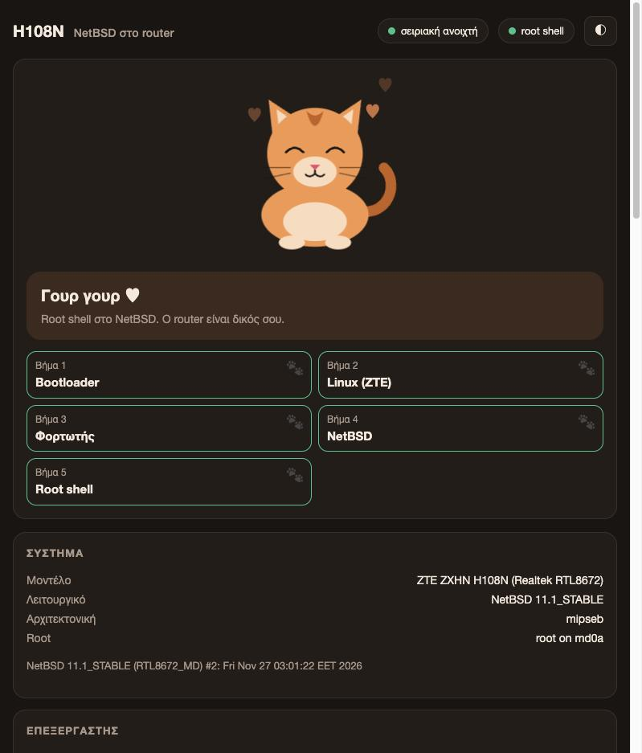
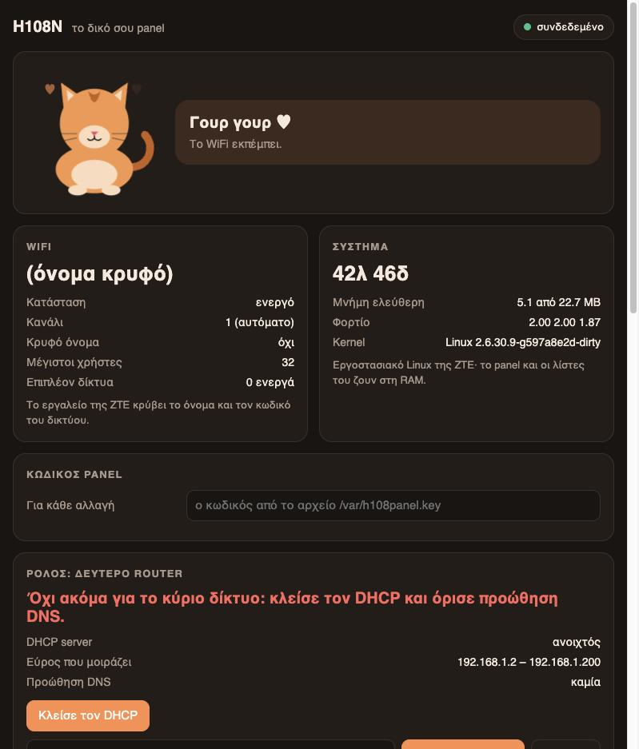

# NetBSD on the ZTE ZXHN H108N (Realtek RTL8672, Lexra RLX5281)

A port of NetBSD 11 to the ZTE ZXHN H108N ADSL router, plus the tools that
were needed to get there: a patched cross compiler, a boot loader that uses
the router's own Linux, a serial dashboard, and a small web panel for the
stock firmware.

**Nothing in this project writes to the router's flash.** NetBSD is loaded
into RAM from the stock Linux, and a power cycle always brings the factory
firmware back.



## Status

NetBSD 11 boots on the real hardware to a root shell on the serial console,
with its root file system in a 3 MB memory disk.

| Works | Missing |
|---|---|
| Serial console (16550, 115200) | Ethernet |
| Timer interrupts at 100 Hz, `delay()` | SPI flash (so nothing is persistent) |
| Interrupt controller | Wi-Fi and ADSL (closed vendor drivers) |
| Lexra cache handling | USB |
| Kernel debugger (DDB) | Real-time clock |
| User programs: `init`, `sh` and about 25 tools | |
| `reboot` (through the watchdog) | |

See [docs/status.md](docs/status.md) for the open problems, including one
crash that has been seen once and not explained.

```
NetBSD 11.1_STABLE (RTL8672_MD) #2
ZTE ZXHN H108N (Realtek RTL8672)
total memory = 32768 KB
avail memory = 25932 KB
rtl8672: timer on CPU interrupt mask 0x8000
cpu0: Realtek RLX5281 (Lexra) CPU (0xdc01) Rev. 0.1 with software emulated floating point
com0 at mainbus0: ns16550a, 16-byte FIFO
com0: console
root on md0a dumps on md0b
NetBSD on the ZTE ZXHN H108N (Realtek RTL8672, Lexra RLX5281)
#
```

## Why this router is awkward

The CPU is a **Lexra** core. It runs the MIPS-I instruction set but leaves
out four instructions that every MIPS compiler and a lot of hand-written
assembly take for granted: `lwl`, `lwr`, `swl` and `swr` (unaligned loads
and stores). Neither stock GCC nor stock NetBSD can target it, and there is
no public documentation for the SoC. Every hardware address used here was
read out of the vendor boot loader and kernel, then checked on the device.

What that meant in practice:

- **Compiler**: a new `-mlexra` option for NetBSD's GCC 12 that stops it from
  emitting the four instructions.
- **Kernel and libc assembly**: byte-wise paths in `bcopy.S`, `bcmp.S` and
  `bzero.S` for Lexra.
- **CPU support**: a CPU table entry, Lexra cache control (CP0 register 20
  instead of the R3000 cache isolation trick), and a replacement for the
  MIPS-I `wbflush()`, which spins on a `bc0f` condition this core never
  provides.
- **Board support**: `sys/arch/evbmips/rtl8672`, about 900 lines: startup,
  console, interrupt controller, timer, watchdog.

## Repository layout

| Path | What it is |
|---|---|
| [`netbsd/`](netbsd/) | Patches against NetBSD `netbsd-11`: compiler option, Lexra support, board port, ramdisk recipe |
| [`loader/`](loader/) | Linux kernel modules and second-stage loaders that boot a kernel from the stock firmware |
| [`tests/hello/`](tests/hello/) | Bare-metal serial test programs used to bring the board up |
| [`dashboard/`](dashboard/) | Local web dashboard that talks to the router over the serial port |
| [`panel/`](panel/) | Web panel that runs on the router's stock Linux (Wi-Fi settings, DNS filter, DHCP switch) |
| [`docs/`](docs/) | How to get root, back up the flash, wire the serial console, build and boot |

## Quick start

You need the router, a 3.3 V USB serial adapter, an Ethernet cable and a
computer that can build NetBSD (Linux, macOS or a BSD).

1. **Get a root shell and back up the flash first.**
   [docs/getting-root.md](docs/getting-root.md) and
   [docs/flash-backup.md](docs/flash-backup.md).
2. **Wire the serial console.** [docs/serial-console.md](docs/serial-console.md).
3. **Build** the tools, kernel, ramdisk and loader module.
   [docs/building.md](docs/building.md).
4. **Boot** it from the router's Linux shell:

   ```sh
   tftp -g -r h108nb.ko -l /var/h108nb.ko <your-pc> 6969
   insmod /var/h108nb.ko
   ```

   The telnet session freezes (Linux is gone) and NetBSD comes up on the
   serial console. How this works: [docs/boot-chain.md](docs/boot-chain.md).

## The dashboard

`dashboard/server.py` owns the serial port and serves a page on
`http://127.0.0.1:8672`: live console, boot stage, system cards, process
list, and a cat whose mood follows the router's state. Python standard
library only.



## The panel for the stock firmware

`panel/` builds one small static program (about 36 KB) that runs on the
router's own Linux, from RAM, and serves a page on port 8672. It reads the
vendor's settings database, shows Wi-Fi, DHCP clients and traffic, and can
change a short list of settings: a few Wi-Fi options, the DHCP server
switch, DNS forwarding, and a DNS block list.



It is built with the same NetBSD cross compiler and talks to the Linux
kernel directly, without a C library. See [panel/README.md](panel/README.md).

## Hardware facts

The full table is in [docs/hardware.md](docs/hardware.md). The short version:

| | |
|---|---|
| SoC | Realtek RTL8672 (the vendor tree calls it RTL8676) |
| CPU | Lexra RLX5281, PRID `0x0000dc01`, big-endian MIPS-I, 64-entry R3000-style TLB |
| RAM / flash | 32 MB / 8 MB SPI at `0xBD000000` |
| UART | 16550A at `0xB8002100`, registers 4 bytes apart, IRQ 13 |
| Interrupt controller | mask `0xB8003000`, status `0xB8003004` |
| Timer / watchdog | `0xB8003100` / `0xB800311C` |
| Stock firmware | Linux 2.6.30.9, Realtek RSDK GCC 4.4.7, BusyBox 1.01 |

## Safety

- Keep a flash backup before you try anything, and keep it private: it
  contains your Wi-Fi keys and ISP credentials.
- The stock boot loader's `xmodem` and `tftp` commands are **firmware
  upgrade** paths, not "load to RAM". This project does not use them.
- The loader and the panel run from RAM. The panel's Wi-Fi and DHCP
  changes, however, go into the router's saved settings, exactly as if you
  had made them in the factory web interface.
- This is experimental software for one specific board revision
  (hardware "H108N V2.5", firmware `V2.5.0_WindT13`). Other revisions may
  use different addresses. You use it at your own risk.

## License

New code in this repository is under the BSD 2-Clause license, see
[LICENSE](LICENSE). The files under `netbsd/patches/` are changes to NetBSD
and GCC sources and carry the licenses of the files they modify.

No vendor firmware, binaries or documentation are included.
