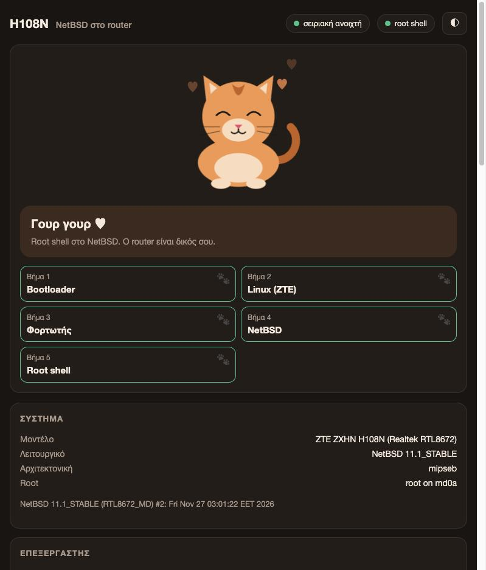

# Serial dashboard

A local web page for watching and driving the router over its serial
console. NetBSD on this board has no network yet, so this is its window to
the outside.



```sh
python3 server.py [PORT] [SERIAL_DEVICE] [LOGFILE]
```

Defaults: port 8672, device `/dev/cu.PL2303G-USBtoUART80` (pass your own),
log `console.log` next to the script. Python standard library only.

- Records everything the router prints and streams it to the page.
- Follows the boot stage from the text: boot loader, Linux, loader,
  NetBSD, shell.
- When a NetBSD shell is up, runs a few read-only commands in the
  background (`sysctl`, `df`, `ps`, `dmesg`) to fill the cards, and keeps
  their output out of the visible console.
- Lets you type commands, and reboot the router when NetBSD is running.

The server binds to `127.0.0.1` only and accepts requests only from its own
page, because it can type into a root shell. The page text is in Greek.
