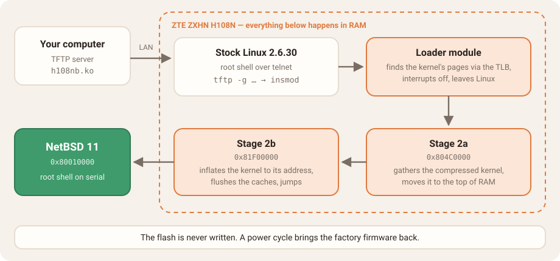

# How NetBSD gets loaded

The stock boot loader has no safe "load this into RAM and run it" command
(see [serial-console.md](serial-console.md)). So the router's own Linux is
used as the boot loader: it already runs, it has a network client, and it
can load kernel modules.

## Step by step

1. **TFTP.** The router's BusyBox fetches one file, `h108nb.ko`, from your
   computer into `/var` (a RAM disk).

2. **`insmod`.** The file is a Linux kernel module. It carries two blobs:
   the second-stage loader and the NetBSD kernel as a raw DEFLATE stream.

3. **Finding the pages.** A module lives in `vmalloc` memory, so the
   compressed kernel is scattered over physical pages in no particular
   order. For each page the module touches it, probes the TLB (`tlbp`,
   `tlbr`) to learn the physical address, and compares the contents through
   both mappings. If anything does not match, it returns an error and Linux
   carries on.

4. **Leaving Linux.** Interrupts off, caches flushed, jump to a small
   position-independent mover that sits in a `kmalloc` buffer (reachable
   without the TLB).

5. **Stage 2a** runs at `0x804C0000`, inside the old Linux kernel image.
   That region is the one place that is certain not to hold any of the
   loader's own data. It gathers the compressed kernel into the start of
   that region, then moves it, together with stage 2b, to the top of RAM.

6. **Stage 2b** runs at `0x81F00000`. It inflates the kernel to its link
   address `0x80010000`, flushes the caches and jumps. Because it sits at
   the top of RAM, the kernel can be larger than the old Linux image.

7. **NetBSD** stops the watchdog, sets up its console and boots.

## Why a module, and how without kernel headers

The vendor never published this kernel's source, so there are no headers to
build a module against. What a module must contain was read out of the
modules that ship in the firmware:

- a `.modinfo` section with `vermagic` equal to the running kernel's
  (`2.6.30.9-g597a8e2d-dirty mod_unload RLX 32BIT `, with the trailing
  space);
- a `.gnu.linkonce.this_module` section of `0x11c` bytes with the module
  name at `0x0c`, the init pointer at `0xbc` and the exit pointer at
  `0x114`.

The kernel does not use symbol versions, so that is enough. The module
imports two kernel symbols, `printk` and `__kmalloc`.

## The stages that led here

`loader/build.sh` still builds the three small modules that were used to
get this far, one risk at a time:

| Module | What it proved |
|---|---|
| `h108s1.ko` | The kernel accepts a module built with the NetBSD toolchain |
| `h108s2.ko` | Jumping out of Linux into our own code works (assembly test) |
| `h108s3.ko` | C code from the patched compiler runs, the watchdog can be stopped |

Their payloads are the programs in `tests/hello`.

## Sizes

The current kernel with its memory disk is about 6 MB and compresses to
1.7 MB. The loader accepts up to 4.8 MB compressed. The practical limit is
the free memory of the stock Linux (about 5 MB), because `insmod` holds
several copies of the module for a moment.
