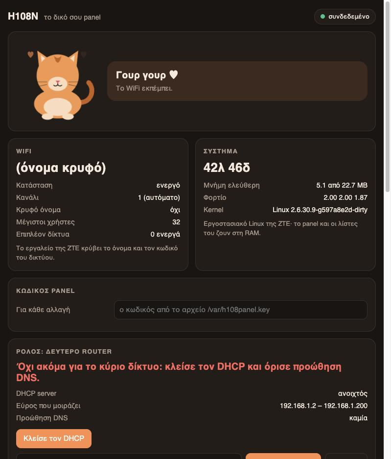

# Panel for the stock firmware

One static program for the router's own Linux. It serves a page on port
8672 and a small API behind it. It runs from RAM and disappears on reboot.



## What it does

- **Status** (no password): Wi-Fi tables, DHCP clients, interface counters,
  uptime, memory, load. Key and passphrase fields are filtered out, and the
  vendor's tool masks the network name itself.
- **Wi-Fi settings**: on/off, name, hidden name, channel, maximum clients,
  passphrase.
- **Second-router mode**: switch the DHCP server off, and forward DNS to
  another router.
- **DNS filter**: names you add are answered with `0.0.0.0`.

Settings are read and written with the vendor's tool,
`sendcmd 1 DB p|set|save`. DNS blocking and forwarding use the files of the
vendor's dnsmasq in `/var/tmp`; a helper process restores the panel's lines
if the vendor daemon rewrites those files.

## Build and run

```sh
TOOLS=/path/to/netbsd/tools/bin sh build.sh     # -> ../loader/tftp/h108panel
```

```sh
# on the router
tftp -g -r h108panel -l /var/h108panel <your-pc> 6969
chmod +x /var/h108panel
echo 'your-panel-password' > /var/h108panel.key
/var/h108panel
```

Without the key file the panel is read-only. `h108panel -d` additionally
allows reading any settings table and a few fixed files without a password;
that mode is for development only.

## Things to know

- **Choose a real password.** Anyone on the same network can open the
  panel; the password is all that protects the settings. The minimum length
  is 4 characters, which is too short to rely on.
- **Wi-Fi and DHCP changes are permanent.** They go into the router's saved
  settings, as if made in the factory web interface. DNS forwarding and the
  block list live in RAM.
- **Not everything here has been exercised.** Reading status, DNS blocking
  and DNS forwarding were checked on the device. Changing Wi-Fi settings
  and the DHCP switch through the panel were not tested end to end.
- **DNS blocking is by exact name**, not by domain suffix, and only affects
  devices that use this router as their DNS server.
- The program is written without a C library and talks to the Linux kernel
  directly (MIPS o32 system calls), so that it can be built with the NetBSD
  cross compiler used for the rest of this project.
